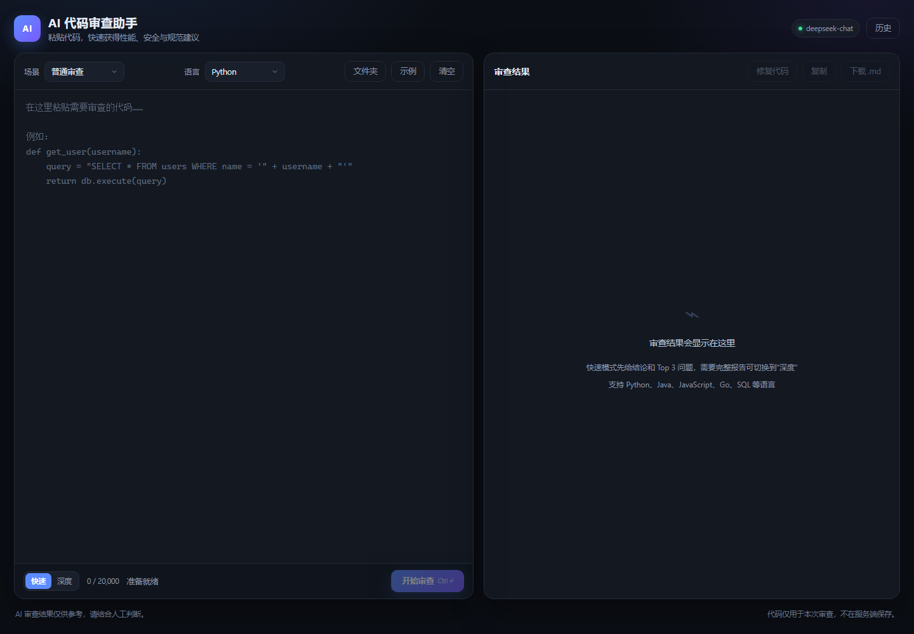
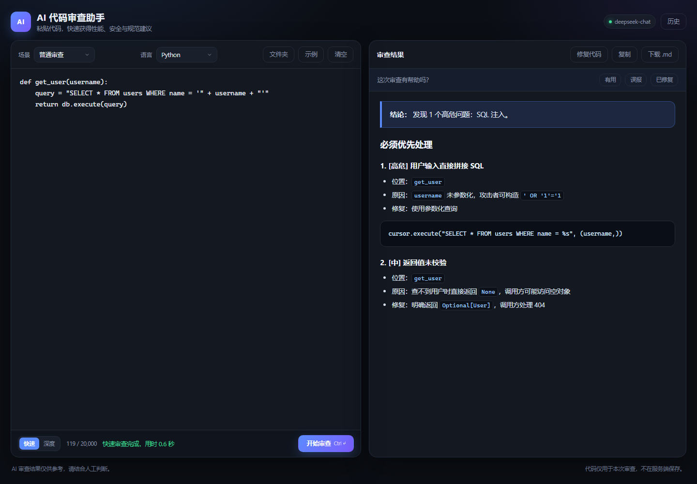
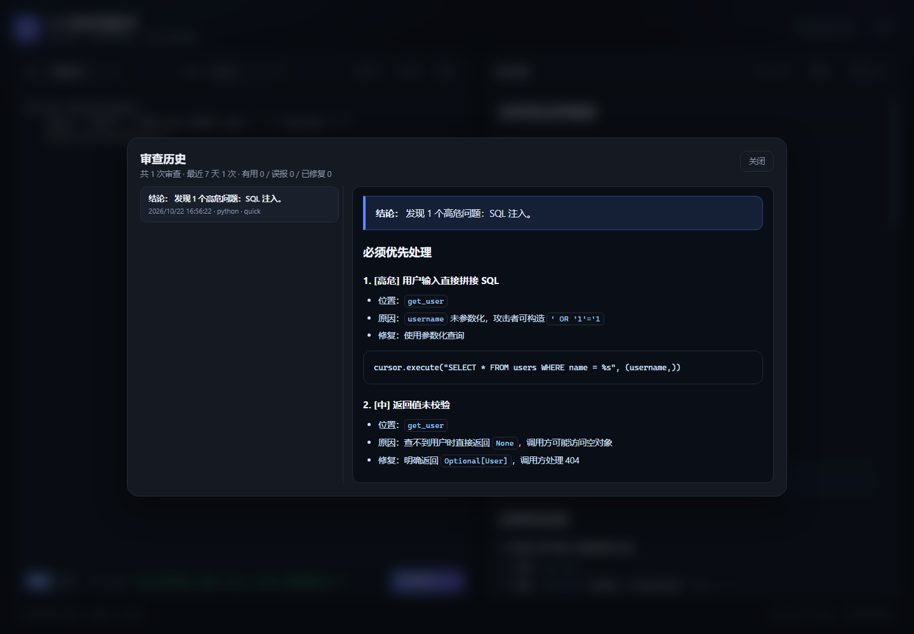
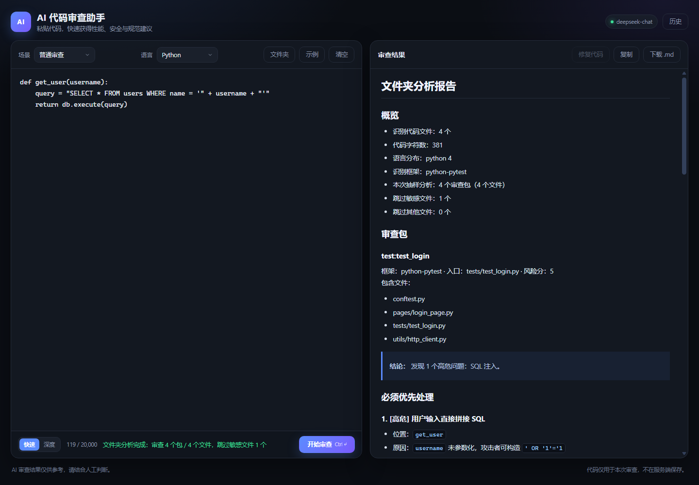
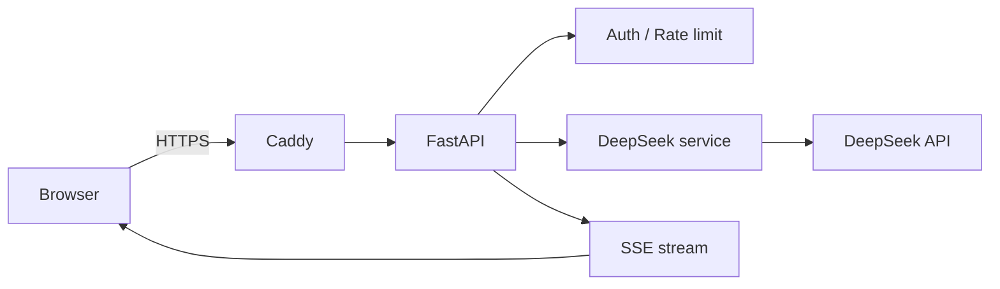

# AI 代码审查助手

一个可以直接给别人用的网页工具：粘贴代码，选择语言，几秒内获得性能、安全与代码规范建议。

后端使用 FastAPI，模型调用 DeepSeek Chat Completions API。前端是原生 HTML/CSS/JS，不需要 Node.js 构建。

## 项目截图

| 首页 | 单文件审查 |
|---|---|
|  |  |

| 历史与反馈 | 文件夹分析 |
|---|---|
|  |  |

## 功能

- 网页端代码编辑器，支持 Python、Java、JavaScript、Go、SQL 等语言
- **SSE 流式输出**，边生成边显示，不用干等整段审查结果
- **快速 / 深度 / 修复三种模式**：快速模式先给结论和 Top 3 问题，深度模式输出完整报告
- **一键修复代码**：审查后点“修复代码”，生成完整修正代码，可复制或替换编辑器
- **编程题评测 / 测试框架审查**：可粘贴题目检查正确性和边界；也可检查 AI 生成的测试脚本的安全、稳定性问题
- **审查历史 + 反馈闭环**：有用 / 误报 / 已修复，反馈会进入下一次审查的团队记忆
- **文件夹分析**：上传 `.zip`，自动过滤依赖/敏感文件，按调用链生成审查包并抽样审查
- **FrameworkAdapter + Bundle**：Python/pytest 已接入文件夹分析；Spring Boot 保留实验性适配器
- **本地 PR Agent**：读取 diff、跑 pytest/静态检查、输出 `file:line` 评论
- 审查结果 Markdown 渲染，可复制、下载 `.md`
- 访问密码登录（可选）
- 按 IP 限流、单次代码长度限制、请求体大小限制、输出 token 限制
- `/health` 健康检查，方便部署监控
- 自带 `test_api.py` 自检脚本
- **自带 10 个安全/性能用例的评测脚本**，输出关键词检出率、延迟和 token 用量
- GitHub Actions CI：Python 编译、前端 JS 语法检查、Docker 镜像构建
- Docker + Caddy 一键部署，自动 HTTPS

## 本机运行

```powershell
cd D:\FastAPI
.\.venv\Scripts\Activate.ps1

$env:DEEPSEEK_API_KEY = "sk-你的真实Key"

# 可选：设置访问密码。不设置则任何人打开页面都能用（仅建议本机）
$env:ACCESS_PASSWORD = "你自己的访问密码"

uvicorn main:app --reload
```

浏览器打开：

```text
http://127.0.0.1:8000
```

如果设置了 `ACCESS_PASSWORD`，会先出现访问密码页面。

> 不要把 `DEEPSEEK_API_KEY` 写进代码或提交到 Git。

## 环境变量

| 变量 | 默认值 | 说明 |
|---|---|---|
| `DEEPSEEK_API_KEY` | 无 | 必填，DeepSeek API Key |
| `DEEPSEEK_MODEL` | `deepseek-chat` | 模型名，按控制台可用模型填写 |
| `DEEPSEEK_API_URL` | `https://api.deepseek.com/chat/completions` | 接口地址，使用中转时可改 |
| `ACCESS_PASSWORD` | 空 | 访问密码；为空表示不启用登录 |
| `COOKIE_SECURE` | `false` | HTTPS 部署时设为 `true` |
| `SESSION_TTL_SECONDS` | `604800` | 登录有效期，默认 7 天 |
| `REVIEW_DB_PATH` | `data/reviews.db` | SQLite 历史库路径；Docker 中默认挂载 `./data` |
| `MAX_CODE_CHARS` | `20000` | 单次提交代码最大字符数 |
| `MAX_OUTPUT_TOKENS` | `4096` | 深度模式最大输出 token 数 |
| `QUICK_MAX_OUTPUT_TOKENS` | `1000` | 快速模式最大输出 token 数，越小越快 |
| `FIX_MAX_OUTPUT_TOKENS` | `4096` | 修复模式最大输出 token 数，修复代码较长时需要留足 |
| `PROBLEM_MAX_OUTPUT_TOKENS` | `2000` | 编程题评测最大输出 token 数 |
| `TEST_REVIEW_MAX_OUTPUT_TOKENS` | `2000` | 测试框架审查最大输出 token 数 |
| `FOLDER_MAX_FILES` | `5` | 最多审查的审查包数量（代码内部上限 5） |
| `FOLDER_MAX_FILE_CHARS` | `20000` | 单个文件最大字符数 |
| `FOLDER_MAX_OUTPUT_TOKENS` | `1200` | 每个审查包的最大输出 token |
| `MAX_FOLDER_ZIP_BYTES` | `31457280` | 上传 zip 的大小上限，默认 30MB |
| `UPSTREAM_TIMEOUT_SECONDS` | `120` | 调用 DeepSeek 的读取超时 |
| `RATE_LIMIT_PER_MINUTE` | `30` | 每 IP 每分钟请求上限；设为 `0` 关闭 |
| `TRUST_PROXY` | `false` | 在 Caddy/Nginx 后面时设为 `true` |
| `CORS_ORIGINS` | 空 | 前后端分离时填写允许的来源，逗号分隔 |

## 接口

| 方法 | 路径 | 说明 |
|---|---|---|
| GET | `/` | 网页首页 |
| GET | `/docs` | Swagger 调试页 |
| GET | `/health` | 健康检查 |
| GET | `/api/config` | 前端配置（最大长度、模型名） |
| GET | `/api/me` | 当前登录状态 |
| POST | `/api/login` | 访问密码登录 |
| POST | `/api/logout` | 退出登录 |
| POST | `/api/review` | 提交代码审查（一次性返回） |
| POST | `/api/review/stream` | 提交代码审查（SSE 流式返回） |
| POST | `/api/analyze-folder` | 上传 `.zip`，抽样分析整个文件夹 |
| GET | `/api/reviews` | 最近审查历史 |
| GET | `/api/reviews/{id}` | 单条审查详情 |
| POST | `/api/reviews/{id}/feedback` | 提交反馈：`helpful` / `false_positive` / `fixed` |
| GET | `/api/insights` | 审查与反馈统计 |

审查请求示例：

```json
{
  "code_snippet": "def add(a, b):\n    return a + b",
  "language": "python",
  "mode": "quick"
}
```

`mode` 支持：

| mode | 输出 | 用途 |
|---|---|---|
| `quick`（默认） | 结论 + Top 3 问题 | 日常快速检查 |
| `deep` | 完整审查报告 | 重要代码、全面建议 |
| `fix` | 一个完整代码块 + 修改说明 | 生成可替换的修复代码 |

`task` 支持：

| task | 用途 |
|---|---|
| `review`（默认） | 普通代码审查 |
| `problem` | 编程题评测，需要同时传 `problem_statement` |
| `test_framework` | 自动化测试框架/脚本审查 |

编程题请求示例：

```json
{
  "code_snippet": "def two_sum(nums, target): ...",
  "language": "python",
  "task": "problem",
  "problem_statement": "给定整数数组和目标值，返回和为目标值的两个下标。"
}
```

`fix` 模式通常由页面上的“修复代码”按钮发起，也可以直接调接口：

```json
{
  "code_snippet": "def get_user(username): ...",
  "language": "python",
  "mode": "fix",
  "review_result": "上一轮审查的结论，可选"
}
```

`fix` 模式下，返回的 `review_result` 是“代码块 + 修改说明”，前端会提取第一个代码块展示，并允许替换编辑器。

成功响应：

```json
{
  "status": "success",
  "mode": "quick",
  "message": "代码审查完成",
  "review_result": "> **结论：** ...",
  "usage": {
    "prompt_tokens": 1200,
    "completion_tokens": 500,
    "total_tokens": 1700
  }
}
```

### 流式响应格式

`POST /api/review/stream` 返回 `text/event-stream`，每条事件都是 JSON：

```text
data: {"type":"start","mode":"quick"}

data: {"type":"delta","content":"> **结论：** 存在 SQL 注入\n"}

data: {"type":"delta","content":"## 安全漏洞\n"}

data: {"type":"done"}
```

如果上游出错：

```text
data: {"type":"error","message":"DeepSeek API Key 无效或已过期"}
```

### 快速 / 深度 / 修复怎么选

| 模式 | 输出 | 默认最大 token | 适合 |
|---|---|---|---|
| `quick` | 结论 + Top 3 问题 | 1000 | 日常提交前快速检查 |
| `deep` | 完整审查报告 | 4096 | 重要代码、需要全面建议 |
| `fix` | 完整修复代码 + 修改说明 | 4096 | 审查后生成可替换的代码 |

页面底部可以直接切换模式。快速模式会要求模型：

- 第一行先给结论
- 最多列 3 个最高风险问题
- 不复述代码，不写客套话
- 总长度控制在 600 字以内

这既减少输出，也让用户第一时间知道该看哪里。

修复模式由结果区的“修复代码”按钮触发。它会返回一个完整代码块和修改说明，页面会弹出预览，确认后可以替换编辑器。修复比审查更耗时，而且 AI 可能引入新问题，替换前务必人工确认并运行测试。

### 编程题 / 测试框架场景

页面左上角的“场景”可以选择：

| 场景 | `task` | 输入 | 重点输出 |
|---|---|---|---|
| 普通审查 | `review` | 一段代码 | 安全、性能、规范 |
| 编程题 | `problem` | 题目描述 + 题解代码 | 通过/不通过、边界用例、反例、复杂度 |
| 自动化测试 | `test_framework` | 测试框架/脚本代码 | 安全、边界、清理、稳定性、断言有效性 |

编程题模式会要求模型：

- 先给“通过 / 不通过 / 部分通过”
- 对照题目检查输入输出和约束
- 至少给 5 个测试用例
- 不通过时给最小反例
- 分析时间/空间复杂度

> 编程题模式是**静态分析**，不会真的执行代码。它可以帮你找逻辑漏洞和边界遗漏，但不能替代在线判题或本地测试。

自动化测试模式会重点检查：

- 硬编码密钥、命令注入、路径遍历
- 超时、重试、异常、资源清理
- 共享状态、执行顺序依赖、并行安全
- 硬编码 `sleep`、脆弱选择器
- 断言是否真的验证业务

### 历史与反馈

每次审查成功后会写入 SQLite（默认 `data/reviews.db`）：

- 语言、模式、代码 hash、代码字符数
- 审查摘要和完整审查文本
- **不存原始代码**

结果区会出现反馈按钮：

```text
有用 / 误报 / 已修复
```

反馈会汇总成一段“团队历史反馈”，在下一次同语言审查时注入 Prompt，例如：

```text
最近 90 天，python 审查反馈：有用 5 次，误报 2 次，已修复 3 次。
对于该语言下不确定的问题，请降低置信度，避免重复误报。
```

页面右上角的“历史”可以查看最近审查、详情和统计。

> 当前是单工作区版本：没有用户/团队隔离，也没有权限控制。做成多人产品时，应加 `team_id`、用户表，并把 SQLite 换成 Postgres。
>
> Docker Compose 已把 `./data` 挂载到 `/app/data`，否则容器重启后历史会丢。Render/Railway 这类平台默认文件系统也是临时的，生产环境需要持久磁盘或改用 Postgres。

### 文件夹分析

页面左上角的“文件夹”按钮可以上传 `.zip`：

```text
上传 zip
  ↓
内存中解压、过滤
  ↓
跳过依赖目录、二进制、敏感文件
  ↓
按风险分排序
  ↓
生成审查包（test → page → util）
  ↓
每个审查包调用一次模型
  ↓
汇总成“文件夹分析报告”
```

默认限制：

- zip ≤ 30MB
- 解压后 ≤ 100MB
- 最多 500 个条目
- 单文件 ≤ 20,000 字符
- 最多审查 5 个审查包（`FOLDER_MAX_FILES`）
- 每个审查包最多 6 个文件进入模型

自动跳过：

- `.git/`、`.venv/`、`node_modules/`、`dist/`、`build/`、`__pycache__/`
- 图片、视频、二进制、压缩包
- `.env`、私钥、`secrets.yml`、`credentials.json`
- 内容里检测到私钥/AWS Key/疑似硬编码密码的文件

报告会列出被跳过的敏感文件名，但不会把内容发给模型。

> 这是**抽样审查**，不是全仓库逐行审查。报告里的文件树和 import 只提供有限上下文，跨文件符号仍可能不完整。

### FrameworkAdapter + Bundle

`review_bundles.py` 定义了统一骨架：

```text
FrameworkAdapter
  ├─ PythonPytestAdapter   已实现
  └─ SpringBootAdapter     骨架/实验性
```

Python/pytest 适配器会：

- 解析 `ast` import
- 生成模块 -> 文件映射
- 建立正向/反向依赖
- 自动带 `conftest.py`
- 把 `test -> page -> util` 打成一个 Bundle

Spring Boot 适配器目前是骨架：

- 识别 `@RestController` / `@Controller`
- 用 Java import 建立简单类依赖
- 生成 Controller Bundle
- 标记为 `experimental=True`

运行验证：

```powershell
python test_bundles.py
```

> Python/pytest 的 Bundle 已经接入 `folder_review.py`：上传 zip 后会优先按审查包调用模型，而不是逐文件审查。Spring Boot 适配器仍是实验性骨架。

### 本地 PR Agent

`pr_agent.py` 是一个本地 CLI，先跑通“PR 审查 Agent”的闭环：

```text
读取 diff
  ↓
找相关 Bundle
  ↓
跑测试（可选）
  ↓
调用模型
  ↓
输出 file:line 评论
```

用法：

```powershell
# 用 diff 文件
python pr_agent.py --repo . --diff changes.patch --run-tests

# 用 git diff
python pr_agent.py --repo . --base HEAD~1 --run-tests

# 只验证 diff、上下文和测试，不调用模型
python pr_agent.py --repo . --diff changes.patch --run-tests --dry-run

# 不用 pytest 的项目
python pr_agent.py --repo . --diff changes.patch --run-tests `
  --test-command "python -m unittest discover -q"
```

输出：

- 变更文件
- 上下文 Bundle
- 测试命令、返回码、日志
- 审查意见（JSON 评论，按 `file:line` 展示）

限制：

- 当前是**本地 CLI**，还没有接 GitHub App / Webhook
- 会执行本地测试命令，只在你自己信任的仓库里使用
- 默认测试命令是 `python -m pytest -q`
- `--dry-run` 不调用模型，适合先验证环境和测试

## 自检

服务启动后，在另一个终端运行：

```powershell
cd D:\FastAPI
.\.venv\Scripts\Activate.ps1

# 如果服务设置了访问密码，测试脚本也需要同一个密码
$env:ACCESS_PASSWORD = "你自己的访问密码"

# 可选：测试部署后的地址（默认 http://127.0.0.1:8000）
# $env:REVIEW_BASE_URL = "https://your-domain.com"

python test_api.py

# 可选：额外测试 SSE 流式接口（会多调用一次模型）
# python test_api.py --with-stream
```

全部通过时输出：

```text
自检结果：N 项通过，0 项失败
全部通过：服务、参数校验、DeepSeek 调用均正常。
```

脚本默认真实调用一次模型，其余用例只验证参数校验；加上 `--with-stream` 会再调用一次，验证流式接口。

> 如果刚刚在页面上连续点过几次审查，建议等一分钟再跑，避免触发每分钟限流。

## 效果评测

`eval/` 目录下有一组 10 个常见安全/性能问题的用例：

- SQL 注入、XSS、命令注入、路径遍历
- 硬编码密钥、弱哈希、不安全反序列化
- N+1 查询、竞态条件、资源泄漏

运行：

```powershell
cd D:\FastAPI
.\.venv\Scripts\Activate.ps1
python eval/run_eval.py
```

本地实测结果（`deepseek-chat`，2026-10-21）：

| 用例 | 结果 | 延迟 |
|---|---|---|
| SQL 注入 | PASS | 6.4s |
| XSS | PASS | 5.5s |
| 硬编码密钥 | PASS | 6.0s |
| 命令注入 | PASS | 6.6s |
| 路径遍历 | PASS | 6.3s |
| 弱哈希 | PASS | 7.0s |
| N+1 查询 | PASS | 6.8s |
| 竞态条件 | PASS | 6.5s |
| 不安全反序列化 | PASS | 7.1s |
| 资源泄漏 | PASS | 6.3s |

汇总：

```text
检出率：10/10 (100%)
平均延迟：6441 ms
总 token：13061
```

> 这是基于关键词命中的工程冒烟评测，不等同于严格的准确率评测。它适合在修改 Prompt、模型或审查逻辑后快速发现明显回归，详细说明见 [eval/README.md](eval/README.md)。

## CI

`.github/workflows/ci.yml` 在 push / pull request 时执行：

- 安装 Python 依赖
- `python -m compileall` 检查后端语法
- `node --check` 检查前端 JS 语法
- `docker build` 检查镜像能否构建

## Docker 部署

### 1. 准备配置

```powershell
cd D:\FastAPI
Copy-Item .env.example .env
notepad .env
```

至少修改：

```env
DEEPSEEK_API_KEY=sk-你的真实Key
ACCESS_PASSWORD=换成一个强密码
```

如果通过 HTTPS 访问，保持 `COOKIE_SECURE=true`；如果只是本地 HTTP 测试，改成 `false`。

### 2. 准备域名

把 `Caddyfile` 里的 `your-domain.com` 换成你的域名，并让域名 A 记录指向服务器。

如果只想用 IP 测试，可以改成：

```text
:80 {
    reverse_proxy app:8000
}
```

### 3. 启动

```powershell
docker compose up -d --build
docker compose logs -f app
```

Caddy 会自动申请 HTTPS 证书。浏览器访问：

```text
https://your-domain.com
```

注意：

- 只暴露 80/443，不要单独把 8000 暴露到公网
- 中国大陆服务器绑定域名通常需要 ICP 备案
- `docker compose down` 停止，`docker compose up -d` 重新启动

### 4. 快速平台部署（Render / Railway / Fly.io）

这些平台可以直接识别 `Dockerfile`，并在运行时注入 `PORT` 环境变量。创建服务后设置：

```text
DEEPSEEK_API_KEY=sk-你的真实Key
ACCESS_PASSWORD=你的访问密码
COOKIE_SECURE=true
TRUST_PROXY=true
```

平台会自动提供 HTTPS 域名，不需要自己配 Caddy。公开 Demo 建议把额度调低：

```text
RATE_LIMIT_PER_MINUTE=5
MAX_CODE_CHARS=8000
MAX_OUTPUT_TOKENS=2048
```

## 安全说明

- DeepSeek Key 只存在服务端环境变量中，不会发送到浏览器
- 服务端不保存用户代码；正常请求只记录模型和 token 用量，异常时会记录上游返回的少量片段用于排查
- 访问密码、限流、代码长度上限用于防止额度被滥用
- 代码和审查结果都属于不可信内容，前端渲染 Markdown 时使用 DOMPurify 过滤
- 前端依赖 CDN 上的 marked/DOMPurify；生产环境建议下载到 `static/vendor` 自托管，避免 CDN 不可用或供应链风险
- AI 审查结果仅供参考，不能替代人工 Code Review
- AI 修复建议可能引入新问题，替换编辑器前必须人工确认并运行测试
- 审查历史存 SQLite；默认不存原始代码，但审查文本可能引用代码片段，需保护数据库文件和备份
- 文件夹分析在内存中解压，不会被应用持久化；但上传文件可能被 Web 框架临时缓存，处理结束会释放
- 敏感文件检测是启发式的，不是 100% 可靠；真正敏感的项目应使用本地 Agent 或私有化部署
- 当前是单工作区，没有用户/团队隔离；多人产品必须增加 `team_id`、用户权限和审计
- 会话和限流记录保存在进程内存中，重启服务后会失效；多实例部署时应换成 Redis

## 架构



- 前端只与 FastAPI 通信，不接触 DeepSeek Key
- `/api/review` 一次性返回完整结果，`/api/review/stream` 用 SSE 逐步返回
- `services/deepseek.py` 封装模型调用与 SSE 解析，`eval/` 负责效果评测

## 设计取舍

- **SSE 而不是 WebSocket**：代码审查是单向流式输出，SSE 更简单，也更容易穿过代理。
- **普通接口和流式接口并存**：普通接口便于脚本调用和评测，流式接口用于网页交互。
- **会话和限流先用进程内存**：单实例 MVP 足够；部署多实例时换成 Redis。
- **评测先用关键词命中**：成本低、可重复，适合做回归；后续再加 LLM-as-a-Judge 和人工标注。
- **不保存用户代码**：降低隐私风险；需要历史记录时再设计保留策略和删除接口。

## 项目结构

```text
D:\FastAPI\
├─ main.py              FastAPI 后端
├─ storage.py           SQLite 审查历史与反馈
├─ folder_review.py     zip 解压、过滤、风险排序、抽样审查
├─ review_bundles.py    FrameworkAdapter / Bundle 骨架
├─ pr_agent.py          本地 PR 审查 Agent（diff + 测试 + 评论）
├─ data\                本地历史库（已 gitignore）
├─ services\
│  └─ deepseek.py       DeepSeek 调用与流式解析
├─ static\
│  ├─ index.html        页面结构
│  ├─ style.css         页面样式
│  └─ app.js            页面交互（含 SSE 解析）
├─ docs\
│  ├─ screenshot-home.png
│  └─ screenshot-review.png
├─ .github\workflows\ci.yml
├─ eval\
│  ├─ cases.py          评测用例
│  ├─ run_eval.py       评测脚本
│  └─ results.json      最近一次评测结果
├─ test_api.py          端到端自检脚本
├─ test_bundles.py      FrameworkAdapter / Bundle 骨架测试
├─ requirements.txt     Python 依赖
├─ Dockerfile           Docker 镜像
├─ docker-compose.yml   app + Caddy 编排
├─ Caddyfile            反向代理与 HTTPS
├─ .env.example         环境变量模板
├─ .dockerignore        Docker 构建忽略
└─ .gitignore
```

## 后续可以加

- GitHub PR 自动审查与 inline comment
- Postgres + 多租户历史与团队隔离
- finding 级反馈与规则级记忆
- 用户账号、额度与付费
- Prometheus/Sentry 监控
- 评测集扩展到 50–100 条，加入 LLM-as-a-Judge 和人工标注

当前版本优先保证“能安全地给别人用”，以上功能可以按需要逐步增加。
